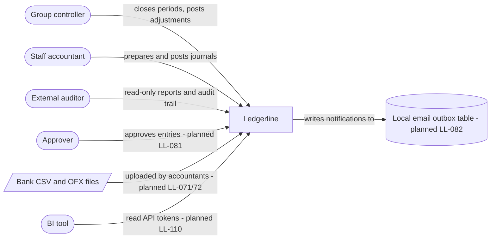
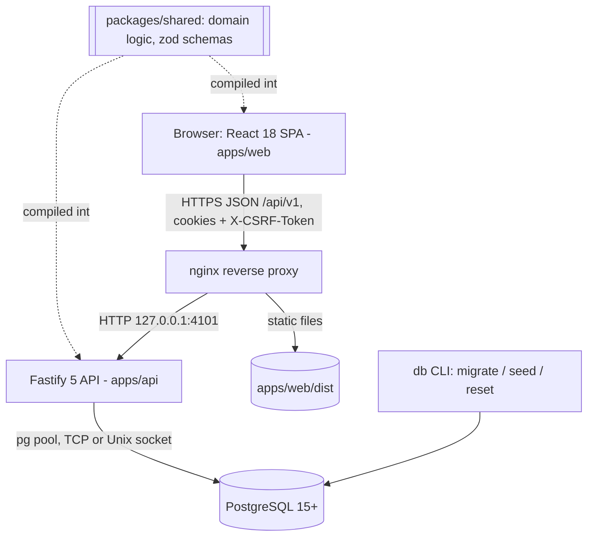

# Architecture overview

Ledgerline is a **modular monolith**: one Fastify API process, one React single-page app, one PostgreSQL database, and a shared TypeScript package that holds the domain rules both sides use. There are no external services at runtime (ADR-0017).

## 1. System context (C4 level 1)



Nothing leaves the deployment: email is an outbox table, bank data arrives as uploaded files, FX rates are maintained by users.

## 2. Applications and data stores (C4 level 2)



| Unit     | Technology                                     | Responsibility                                                                                                  |
| -------- | ---------------------------------------------- | --------------------------------------------------------------------------------------------------------------- |
| Web SPA  | React 18, Vite, React Router, plain CSS tokens | Login, shell with planned sections, chart of accounts, periods, journal editor with live balance, trial balance |
| API      | Node 22, Fastify 5, `pg`, zod, pino            | Auth, RBAC, tenancy, posting engine orchestration, reports, audit                                               |
| Shared   | TypeScript, zod                                | Money math, FX conversion, posting engine, trial balance, period rules, RBAC matrix, schemas                    |
| Database | PostgreSQL 15+ with `btree_gist`               | System of record; enforces ledger invariants with constraints and triggers                                      |
| DB CLI   | `apps/api/src/db/cli.ts`                       | Forward-only migrations, development seed, reset                                                                |

## 3. Components of the API (C4 level 3)

```mermaid
flowchart LR
  subgraph http[http/]
    app[app.ts: buildApp]
    sess[session-hook.ts: loader + CSRF]
    guards[guards.ts: requireAuth / requirePermission]
    err[error-handler.ts]
    thr[login-throttle.ts + bounded-store.ts + client-ip.ts]
  end
  subgraph modules[modules/]
    auth[auth]
    entities[entities]
    accounts[accounts]
    periods[periods]
    fx[fx]
    journals[journals: posting.service]
    reports[reports: trial-balance.service]
    audit[audit]
    pending[pending: 501 stubs]
  end
  shared[[@ledgerline/shared]]
  db[(db/pool.ts, migrate.ts)]
  app --> sess --> guards --> modules
  journals --> shared
  reports --> shared
  accounts --> shared
  periods --> shared
  journals --> fx
  journals --> periods
  journals --> accounts
  modules --> audit
  modules --> db
  auth --> thr
```

### Module boundaries

| Module     | Owns tables                               | May call                                   | Notes                                                                                                     |
| ---------- | ----------------------------------------- | ------------------------------------------ | --------------------------------------------------------------------------------------------------------- |
| `auth`     | `users`, `memberships`, `sessions`        | `audit`                                    | Registration never reveals existing emails                                                                |
| `audit`    | `audit_events`                            | —                                          | Append-only, written in the caller's transaction                                                          |
| `entities` | `entities`                                | `accounts` (template), `audit`             | Every entity-scoped route resolves the entity with `organization_id` first (tenant gate, 404 on mismatch) |
| `accounts` | `accounts`                                | shared hierarchy validation                | Chart changes lock the entity row to serialise hierarchy checks                                           |
| `periods`  | `accounting_periods`, `journal_sequences` | shared period rules                        | Status changes take `FOR UPDATE` on the period                                                            |
| `fx`       | `fx_rates`                                | shared rate parsing                        | Latest spot on/before date; opposite quote inverted exactly                                               |
| `journals` | `journal_entries`, `journal_lines`        | `periods`, `accounts`, `fx`, shared engine | The only writer of ledger rows                                                                            |
| `reports`  | — (read-only)                             | `accounts`, shared trial balance           | Runs in `REPEATABLE READ READ ONLY`                                                                       |
| `pending`  | —                                         | —                                          | Registers every planned route and answers `501` with its ticket                                           |

Rules: modules talk through exported repository/service functions, never through each other's SQL; pure decisions live in `packages/shared` so the browser and server agree byte-for-byte; repositories take `organizationId` explicitly.

## 4. Request lifecycle

```mermaid
sequenceDiagram
  participant C as Client
  participant F as Fastify
  participant H as Hooks
  participant R as Route
  participant S as Service
  participant DB as PostgreSQL
  C->>F: POST /api/v1/entities/:id/journals (cookies, X-CSRF-Token, Idempotency-Key)
  F->>F: genReqId (honours safe X-Request-Id)
  F->>H: onRequest 1: @fastify/cookie parses cookies
  H->>DB: onRequest 2: session loader (keyed hash lookup)
  H->>H: onRequest 3: CSRF double-submit check (unsafe methods)
  F->>R: preHandler: requirePermission('journal.create')
  R->>R: zod parse params/body/headers
  R->>S: createJournal(...)
  S->>DB: BEGIN; period FOR SHARE; accounts; rates
  S->>S: prepareEntry (pure engine)
  S->>DB: insert draft + lines; sequence row lock; mark posted
  S->>DB: INSERT audit_events (same tx)
  S->>DB: COMMIT (deferred balance trigger runs)
  R-->>C: 201 { data, error: null, meta: { requestId } }
  Note over F: onSend adds security headers; errors go through the central handler
```

Order of concerns: **cookie parse → session loader → CSRF → route guard (RBAC) → zod validation → service → transaction → audit in the same transaction → envelope**. The error handler maps `AppError`, zod errors, Fastify 4xx and the ledger SQLSTATEs (`LL002` immutable, `LL003` invariant, `40001`/`40P01` retry) to the envelope; anything else is a logged `500` without details.

## 5. Web application

- `AuthProvider` loads `/auth/me`; `EntityProvider` keeps the selected entity (localStorage, guarded).
- The API client reads the `ll_csrf` cookie and sends it as `X-CSRF-Token` on unsafe methods.
- The journal editor uses `parseAmount`/`formatMinor` from the shared package to show a live per-currency balance; cross-currency entries are confirmed with `POST /journals/preview`.
- Planned sections appear in the sidebar with a **Planned** badge and a page naming the ticket and milestone.

## 6. Deployment view

A single VM runs nginx, the API under systemd, and PostgreSQL locally (see [deployment.md](../operations/deployment.md)). Horizontal scaling of the API requires moving throttle counters to Postgres first (LL-100); everything else is stateless across requests.

## 7. Key decisions

See the [ADR index](../adr/README.md). The most consequential: integer minor units with banker's rounding (ADR-0006), rational FX rates (ADR-0007), group-wise conversion with apportionment (ADR-0009), period locking and deferred database invariants (ADR-0012), gapless numbering (ADR-0008).
