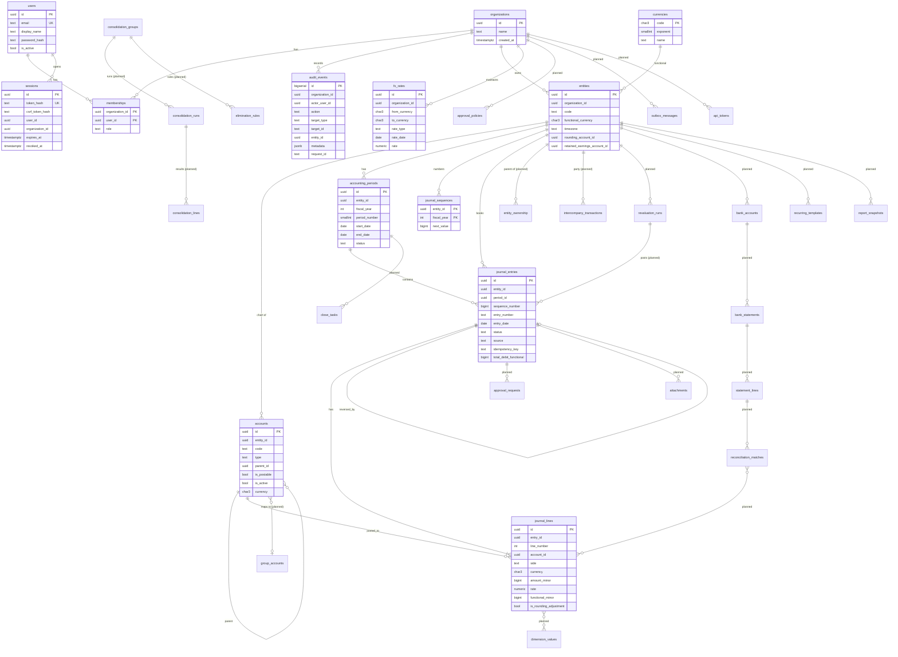

# Data model

PostgreSQL 15+, `btree_gist` extension. All money columns are `bigint` minor units; rates `numeric(24,10)`; timestamps `timestamptz` (UTC); calendar dates `date` (parsed as `YYYY-MM-DD` strings in the API).

## 1. Migrations

| Migration              | Status  | Contents                                                                                                                                                                               |
| ---------------------- | ------- | -------------------------------------------------------------------------------------------------------------------------------------------------------------------------------------- |
| `0001_foundation.sql`  | applied | `organizations`, `users`, `memberships`, `sessions`, `audit_events` + append-only trigger                                                                                              |
| `0002_ledger_core.sql` | applied | `currencies` (seeded), `entities`, `accounts`, `accounting_periods`, `fx_rates`, `journal_sequences`, `journal_entries`, `journal_lines`, immutability and deferred invariant triggers |
| `0003_…` onward        | planned | Tables marked _planned_ below, one migration per ticket                                                                                                                                |

## 2. Target ERD

## 3. Implemented tables

### organizations, users, memberships

Tenancy root. `users.email` is lower-case (CHECK) and unique. `memberships.role` ∈ owner, admin, controller, accountant, approver, auditor.

### sessions

`token_hash` and `csrf_token_hash` are HMAC-SHA256 of the random tokens keyed by `SESSION_SECRET` — raw tokens are never stored. Indexes: unique `token_hash`; `(user_id)`; partial `(expires_at) WHERE revoked_at IS NULL` for cleanup.

### audit_events

Append-only (trigger raises `LL001` on UPDATE/DELETE). Indexes `(organization_id, created_at DESC, id DESC)` for the feed and `(organization_id, target_type, target_id)` for per-object history.

### currencies

Reference data mirrored from `packages/shared/src/money/currency.ts`.

### entities

Legal entities. `timezone` is a canonical IANA name (validated with `Intl`). `rounding_account_id` and `retained_earnings_account_id` reference `accounts(entity_id, id)` via composite, deferrable FKs so the account must belong to the same entity. `UNIQUE (organization_id, code)` and `UNIQUE (organization_id, id)` (target of tenant FKs).

### accounts

`UNIQUE (entity_id, code)`; composite FK `(organization_id, entity_id) → entities`; self FK `(entity_id, parent_id) → accounts(entity_id, id)` keeps parents in the same entity. Header accounts (`is_postable = false`) cannot receive lines (engine check). Index `(parent_id)`.

### accounting_periods

`UNIQUE (entity_id, fiscal_year, period_number)`; `CHECK (end_date >= start_date)`; **exclusion constraint** `EXCLUDE USING gist (entity_id WITH =, daterange(start_date, end_date, '[]') WITH &&)` forbids overlaps.

### fx_rates

`UNIQUE (organization_id, from_currency, to_currency, rate_type, rate_date)` doubles as the lookup index for "latest spot on or before date".

### journal_sequences

One row per (entity, fiscal year); row-locked by posting (ADR-0008).

### journal_entries

Born as `draft`; posting sets `sequence_number`, `entry_number`, `posted_at`, `posted_by` (CHECK enforces they exist when not draft). `UNIQUE (entity_id, idempotency_key)`, `UNIQUE (entity_id, fiscal_year, sequence_number)`. `source` anticipates recurring, reversal, revaluation, import, elimination. Indexes `(entity_id, entry_date, id)` and `(period_id, status)`.
Triggers: `journal_entries_immutable` (BEFORE UPDATE/DELETE), `journal_entries_posted_invariants` (deferred constraint trigger).

### journal_lines

`CHECK amount_minor > 0`, `functional_minor >= 0`, `rate > 0`; `UNIQUE (entry_id, line_number)`; composite FK `(entity_id, account_id) → accounts(entity_id, id)` prevents cross-entity postings. Index `(account_id, entry_id)` serves the trial balance aggregate. Trigger `journal_lines_immutable` blocks INSERT/UPDATE/DELETE when the parent is not a draft.

## 4. Planned tables

| Table                                                                                              | Purpose                                           | Ticket        |
| -------------------------------------------------------------------------------------------------- | ------------------------------------------------- | ------------- |
| `entity_access`                                                                                    | user ↔ entity assignments                         | LL-017        |
| `user_invitations`                                                                                 | pending invites with hashed tokens                | LL-014        |
| `signup_verifications`                                                                             | email verification tokens for sign-up             | LL-120        |
| `mfa_factors`                                                                                      | TOTP secrets (encrypted)                          | LL-018        |
| `dimensions`, `dimension_values`, `journal_line_dimensions`                                        | analysis dimensions                               | LL-026        |
| `entity_ownership`                                                                                 | parent/child with ownership % and effective dates | LL-027        |
| `group_accounts`, `account_group_mappings`                                                         | group chart for consolidation                     | LL-025        |
| `attachments`                                                                                      | file metadata, SHA-256, local path                | LL-037        |
| `close_tasks`                                                                                      | checklist per period                              | LL-041        |
| `revaluation_runs`                                                                                 | run header, links to posted and reversal entries  | LL-052        |
| `intercompany_transactions`                                                                        | paired entry ids, counterparty, status            | LL-060        |
| `consolidation_groups`, `consolidation_runs`, `consolidation_lines`, `elimination_rules`           | consolidation                                     | LL-062–LL-066 |
| `bank_accounts`, `bank_statements`, `statement_lines`, `reconciliation_matches`, `import_profiles` | reconciliation                                    | LL-070–LL-076 |
| `approval_policies`, `approval_requests`, `approval_decisions`                                     | approvals                                         | LL-080–LL-083 |
| `notifications`, `outbox_messages`                                                                 | in-app notifications and email outbox             | LL-082        |
| `recurring_templates`, `recurring_runs`                                                            | recurring journals                                | LL-085–LL-087 |
| `report_snapshots`                                                                                 | frozen reports at close                           | LL-095        |
| `budgets`, `budget_lines`                                                                          | budget vs actual                                  | LL-097        |
| `account_balances_daily`                                                                           | summary table for large ledgers                   | LL-096        |
| `auth_throttle_counters`                                                                           | shared throttle state for multi-instance          | LL-100        |
| `api_tokens`                                                                                       | hashed read tokens with scopes                    | LL-110        |

## 5. Integrity summary

| Invariant                                                              | Where                               |
| ---------------------------------------------------------------------- | ----------------------------------- |
| Posted entry balances in functional currency and matches header totals | Deferred trigger (`LL003`) + engine |
| Posted rows immutable                                                  | Triggers (`LL002`)                  |
| Lines, accounts, periods belong to the entry's entity                  | Composite FKs                       |
| No overlapping periods                                                 | Exclusion constraint                |
| No posting into closed periods                                         | Engine + commit-time trigger        |
| Gapless numbering                                                      | Counter row + unique constraint     |
| Audit append-only                                                      | Trigger (`LL001`)                   |
