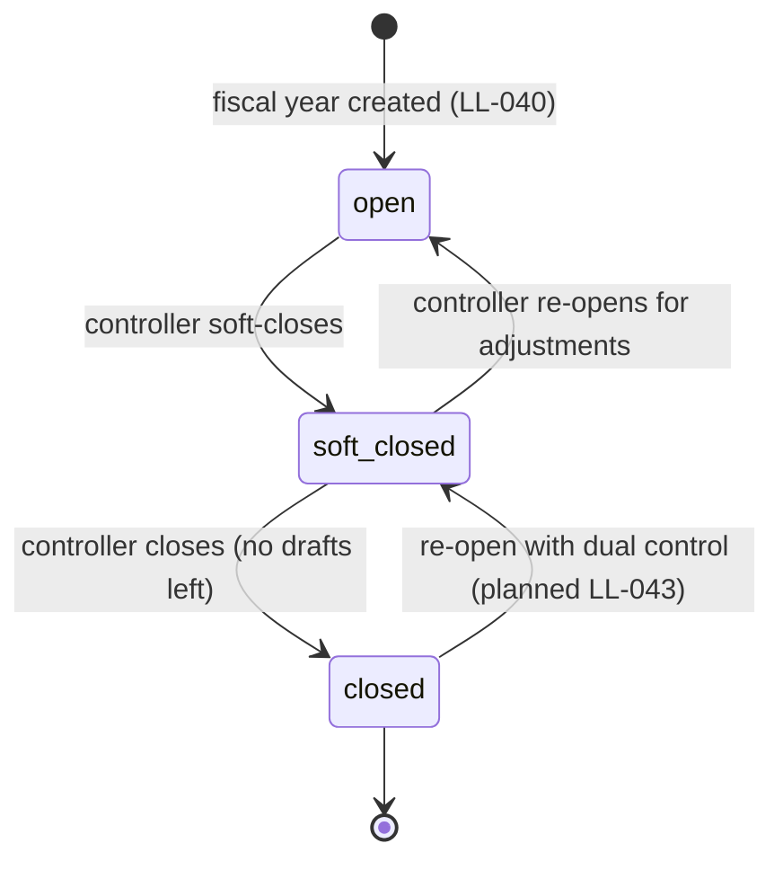
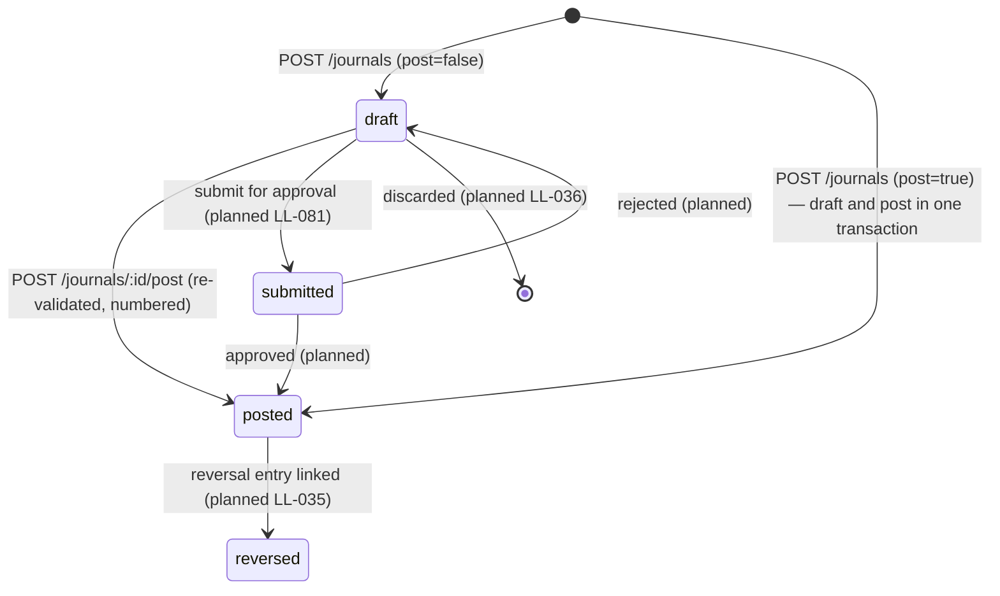
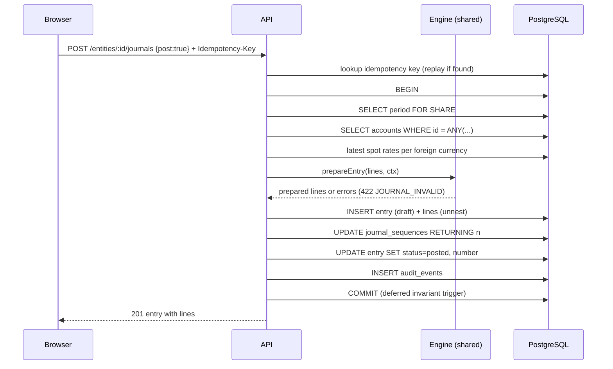

# System design

This document explains how the hard parts work: state machines, the posting engine, the trial balance, concurrency, and the designs for planned algorithms. Code references are to `packages/shared/src` (pure logic) and `apps/api/src` (orchestration).

## 1. Money model

- Amounts are `bigint` **minor units** per currency exponent (`money/currency.ts`: USD 2, JPY 0, KWD 3 …). Wire format is decimal strings (`"1250.00"`), never JS numbers.
- `parseAmount` rejects malformed input and **excess precision** (`1.005 USD` → `EXCESS_PRECISION`); it never rounds user input.
- The only lossy operation is division, always via `divideHalfEven(n, d)` (banker's rounding, ADR-0006). Error bound: `|q·d − n| ≤ d/2`, property-tested.
- Exchange rates are exact rationals (`money/rate.ts`, ADR-0007): `"1.0845"` → `2169/2000`; inversion swaps numerator and denominator.
- Conversion: `functional = halfEven(amount × num × 10^e_to, den × 10^e_from)`.

## 2. State machines

### 2.1 Accounting period



| Status        | Who may post                                        | Enforced by                                               |
| ------------- | --------------------------------------------------- | --------------------------------------------------------- |
| `open`        | `journal.post` (accountant, controller, owner)      | `periodPostingRule` + route guard                         |
| `soft_closed` | only `journal.post_soft_closed` (controller, owner) | `assertPeriodAllows` → `403 PERIOD_SOFT_CLOSED`           |
| `closed`      | nobody                                              | `409 PERIOD_CLOSED` and the commit-time trigger (`LL003`) |

Closing is refused with `409 PERIOD_HAS_DRAFTS` while drafts remain, so nothing is stranded.

### 2.2 Journal entry



Posted and reversed entries are immutable (`journal_entries_immutable`, `journal_lines_immutable` triggers). The only permitted change to a posted row is `posted → reversed` with `reversed_by_entry_id` set and every financial column unchanged.

## 3. Posting engine

`prepareEntry(lines, context)` in `ledger/posting.ts` is pure: given the line inputs, the entity's accounts, its functional currency, a rate lookup and the rounding account, it returns either a prepared entry or **all** errors (so the UI can show every problem at once).

### 3.1 Steps

1. **Structure** — at least 2 lines (≤ 500 enforced by the schema).
2. **Per line** (`resolveLine`) — currency known; amount parses with the currency's exponent and is > 0; account exists in this entity, is active, is postable (not a header), and matches the account's currency restriction if any.
3. **Rates** (`resolveRates`) — exactly one rate per currency: explicit line rates must agree (`RATE_CONFLICT`), the functional currency must use 1 (`FUNCTIONAL_RATE_NOT_ONE`), otherwise the rate table (latest spot on/before entry date, either direction) is used; missing → `RATE_MISSING`.
4. **Group-wise conversion** (`convertGroups`, ADR-0009) — lines are grouped by `(currency, side)`. Each group's _total_ is converted once with half-even rounding, then apportioned back to the lines by **largest remainder** (Hamilton): each part gets `floor(T·w/W)`; leftover units go to the largest remainders, ties to the larger weight, then the earlier line.
5. **Balance** — `D = Σ debit functional`, `C = Σ credit functional`, `k` = number of foreign `(currency, side)` totals that were rounded. If `D = C` → done. If `0 < |D − C| ≤ ⌊k/2⌋` the residue is pure rounding: a line to the entity's FX rounding account is appended on the short side (`ROUNDING_ACCOUNT_REQUIRED` if none is configured). Otherwise `UNBALANCED` with debit, credit and difference.

### 3.2 Why group-wise

Per-line conversion breaks balanced entries: three 0.01 EUR debits at 1.5 round to 0.02 USD each (0.06), the 0.03 EUR credit to 0.04. Converting the group total (0.045 → 0.04 half-even) and apportioning it `[2,1,1]` keeps both sides at 0.04. Invariant (property-tested on 300 random multi-currency entries): **an entry balanced in every transaction currency always balances in functional currency without a rounding line.**

### 3.3 Complexity

O(n log n) for n lines (sort inside each apportionment); memory O(n). Rate lookups are one indexed query per foreign currency; account lookup is one `id = ANY($1)` query.

### 3.4 Worked example

Debit 0.05 EUR @1.1 and 0.05 GBP @1.1 against a 0.11 USD credit: each foreign total is 0.055 → 0.06 (half-even), `D = 0.12`, `C = 0.11`, `k = 2`, residue 0.01 ≤ 1 → credit 0.01 to `7990 FX Rounding Differences`. A 100.00 EUR @1.0845 debit against 108.44 USD has `k = 1`, residue 0.01 > 0 → `UNBALANCED`.

## 4. Trial balance

`computeTrialBalance(accounts, activity, options)` in `ledger/trial-balance.ts`.

1. SQL (`reports/trial-balance.service.ts`) makes **one pass** over posted lines up to `to`, bucketing functional amounts with `FILTER` clauses into _prior years_ (before fiscal-year start), _year-to-date before `from`_, and _in range_.
2. Balance-sheet accounts carry prior years into opening; income-statement accounts restart at fiscal-year start. Their prior-year net (profit) is added to the configured retained-earnings account's opening, or shown as a synthetic "Prior-year earnings" equity row.
3. Header accounts receive the roll-up of all descendants via ancestor chains (`ancestorChains`, cycle-safe) but are excluded from totals so each posting counts once.
4. Rows are ordered depth-first by code; zero rows hidden unless `includeZero=true`. `isBalanced` checks opening, period and closing columns.

Complexity: SQL O(L) over lines with the `(account_id, entry_id)` index; in memory O(A·depth). The whole read runs in `REPEATABLE READ READ ONLY` so accounts and balances come from one snapshot. Ranges spanning two fiscal years are rejected (`RANGE_SPANS_FISCAL_YEARS`).

## 5. Concurrency and consistency

| Concern                 | Mechanism                                                                                                                                                                                                                                                     |
| ----------------------- | ------------------------------------------------------------------------------------------------------------------------------------------------------------------------------------------------------------------------------------------------------------- |
| Posting vs period close | Posting reads the period `FOR SHARE`; transitions take `FOR UPDATE` (ADR-0012). A post queued behind a close re-reads the row, sees `closed`, fails `PERIOD_CLOSED`.                                                                                          |
| Gapless numbers         | `UPDATE journal_sequences ... RETURNING` row-locks the counter until commit; rollback releases the number (ADR-0008). Lock taken last to keep hold time short.                                                                                                |
| Lock ordering           | Period (share) → sequence row (exclusive). Transitions only lock the period. No cycles, no deadlocks.                                                                                                                                                         |
| Idempotent create       | `UNIQUE (entity_id, idempotency_key)`; a request fingerprint (SHA-256 of payload + `post`) detects key reuse with a different body (`IDEMPOTENCY_KEY_REUSED`); a losing racer catches `23505` and replays the winner.                                         |
| Chart edits             | Account create/patch lock the entity row, so cycle checks see a stable hierarchy.                                                                                                                                                                             |
| Defence in depth        | Deferred constraint trigger checks balance, header totals, ≥ 2 lines, date in period, period not closed at COMMIT; immutability triggers; composite FKs keep lines, accounts and periods inside one entity; exclusion constraint forbids overlapping periods. |
| Reports                 | `REPEATABLE READ READ ONLY` snapshot.                                                                                                                                                                                                                         |
| Login throttles         | Synchronous reservation before any `await` (ADR-0011).                                                                                                                                                                                                        |

## 6. Sequences

### 6.1 Login

```mermaid
sequenceDiagram
  participant B as Browser
  participant A as API
  participant T as Throttles
  participant D as PostgreSQL
  B->>A: POST /auth/login {email, password}
  A->>T: loginByIp.hit(normalised IP) — sync
  A->>T: emailsPerIp.hit(IP, email) — sync
  A->>T: loginByEmail.reserve(email) — sync, counts attempt
  alt any limiter denies
    A-->>B: 429 RATE_LIMITED + Retry-After
  end
  A->>D: find user + membership
  A->>A: scrypt verify (dummy hash if unknown)
  alt invalid
    A->>D: audit auth.login_failed (if user exists)
    A-->>B: 401 INVALID_CREDENTIALS
  else valid
    A->>T: loginByEmail.recordSuccess(email)
    A->>D: INSERT session (HMAC of token, HMAC of CSRF token)
    A->>D: audit auth.login
    A-->>B: 200 profile + csrfToken; Set-Cookie ll_session (HttpOnly), ll_csrf
  end
```

### 6.2 Post a journal



## 7. Planned algorithms

### 7.1 Period-end revaluation (LL-052, ADR-0016)

For each monetary account (cash, receivables, payables flagged by type/tag) and foreign currency `c` with balance `F_c` (in `c`) and carried functional balance `B`: `target = halfEven(F_c × closing_rate)`; `delta = target − B`. One entry per run: delta to the account, offset to `7910 Unrealized FX Gain/Loss`; an automatic reversal dated the first day of the next period (LL-053). Runs are idempotent per (entity, period): re-running reverses the previous run first. Complexity O(A·C) with one aggregate query.

### 7.2 Consolidation with eliminations and NCI (LL-062..LL-066, ADR-0014)

1. Translate each entity's trial balance to the group currency (current-rate method: assets/liabilities at closing, P&L at average, equity historical; difference to CTA — LL-055).
2. Map entity accounts to the group chart (LL-025).
3. Aggregate bottom-up over the entity hierarchy (DFS; ownership edges carry %).
4. Eliminations: intercompany receivable/payable pairs and IC revenue/expense matched by counterparty; matched amounts eliminated, mismatches reported (LL-061) and optionally booked to a suspense account; investment in subsidiary against subsidiary equity at acquisition.
5. NCI = (1 − ownership) × subsidiary net assets (and share of profit), presented in equity and below net income.
6. Persist as an immutable run with entity columns, elimination column and consolidated column. Complexity O(E·A) for E entities and A group accounts.

### 7.3 Reconciliation matching (LL-073, ADR-0015)

Staged, deterministic pipeline over unmatched statement lines S and ledger cash lines L:

1. **Exact**: same amount, same date, normalised reference equal — hash join, O(|S| + |L|).
2. **Window**: same amount within ±3 days, unique candidate — sort by amount then date, O((|S| + |L|) log n).
3. **Many-to-one**: a statement line equal to the sum of up to 4 ledger lines within 7 days — bounded subset sum per amount bucket.
4. **Scored**: remaining pairs scored `0.5·amountMatch + 0.3·dateProximity + 0.2·referenceSimilarity (trigram)`; ≥ 0.85 auto, 0.6–0.85 suggested, else manual.

Each match stores the rule, score and inputs for explanation; confirmed matches lock the statement lines.
