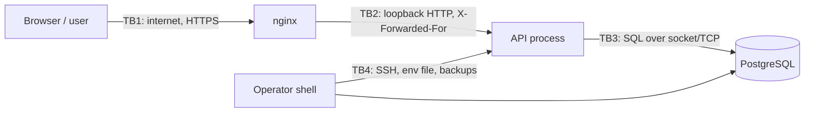

# Threat model

Scope: the API, the SPA, the PostgreSQL database and the single-VM deployment. Method: STRIDE per trust boundary, mapped to OWASP ASVS 4.0.3 controls.

## 1. Assets

| Asset                                 | Why it matters                                    |
| ------------------------------------- | ------------------------------------------------- |
| Posted ledger (journal entries/lines) | Basis of financial statements; tampering is fraud |
| Period status                         | Closing locks reported numbers                    |
| Audit trail                           | Evidence for auditors and regulators              |
| Credentials and sessions              | Account takeover enables all of the above         |
| Tenant isolation                      | Organizations must never see each other's books   |
| FX rates                              | Wrong rates silently misstate every conversion    |

## 2. Trust boundaries

## 3. STRIDE

### TB1 Browser ↔ edge

| Threat                     | Example                                    | Mitigation                                                                                  |
| -------------------------- | ------------------------------------------ | ------------------------------------------------------------------------------------------- |
| **S**poofing               | Credential stuffing, password spraying     | scrypt hashes; per-IP window; per-email progressive backoff; distinct-email cap per IP (§4) |
| **S**poofing               | Session theft via XSS                      | HttpOnly session cookie; React escaping; CSP on API responses; no tokens in localStorage    |
| **T**ampering              | CSRF form post to `/journals`              | SameSite=Lax + double-submit token bound to the session hash                                |
| **R**epudiation            | "I never posted that"                      | `posted_by`, audit event with request id and IP, append-only trail                          |
| **I**nformation disclosure | Email enumeration via register/login       | Identical `202` for register; identical `401` for login; dummy hash timing                  |
| **I**nformation disclosure | Stack traces                               | Central handler returns `INTERNAL_ERROR` only; details in logs                              |
| **D**enial of service      | Large bodies, many lines                   | 1 MiB body limit; ≤ 500 lines per entry; throttles; API-wide limits planned (LL-100)        |
| **E**levation              | Accountant posts into a soft-closed period | Permission `journal.post_soft_closed` checked in the service                                |

### TB2 Edge ↔ API

| Threat                                       | Mitigation                                                                                                  |
| -------------------------------------------- | ----------------------------------------------------------------------------------------------------------- |
| Spoofed `X-Forwarded-For` to dodge IP limits | `TRUST_PROXY` is `false`, a hop count, or an IP/CIDR list — never `true`; required explicitly in production |
| Clear-text cookies                           | `Secure` cookies when `NODE_ENV=production`; nginx terminates TLS                                           |

### TB3 API ↔ database

| Threat                                 | Mitigation                                                                                                                |
| -------------------------------------- | ------------------------------------------------------------------------------------------------------------------------- |
| SQL injection                          | Parameterised queries only; no string-built SQL from input (pagination values are validated integers bound as parameters) |
| Cross-tenant reads                     | Every repository takes `organizationId`; entity gate returns 404; composite FKs keep lines/accounts/periods in one entity |
| Ledger tampering by bugs or manual SQL | Immutability triggers (`LL002`), deferred balance/period trigger (`LL003`), append-only audit (`LL001`)                   |
| Lost updates on concurrent close/post  | `FOR SHARE`/`FOR UPDATE` protocol (ADR-0012)                                                                              |
| Stolen DB dump replaying sessions      | Only HMAC(token, `SESSION_SECRET`) stored                                                                                 |

### TB4 Operator

| Threat                  | Mitigation                                                                                           |
| ----------------------- | ---------------------------------------------------------------------------------------------------- |
| Secrets in git          | `.env` git-ignored; `run.sh` generates a random `SESSION_SECRET`; production refuses the placeholder |
| Backups leaked          | Encrypted at rest by the operator; restore drill (LL-101)                                            |
| Over-privileged DB role | App role owns only its database; no superuser needed (`btree_gist` is a trusted extension)           |

## 4. Authentication throttling

Implemented in `apps/api/src/http/login-throttle.ts`, `bounded-store.ts`, `client-ip.ts` (ADR-0011).

| Limiter                | Key                           | Policy                                                                                                                                   | Default                                |
| ---------------------- | ----------------------------- | ---------------------------------------------------------------------------------------------------------------------------------------- | -------------------------------------- |
| Login by IP            | normalised IP                 | fixed window, all attempts                                                                                                               | 50 / 15 min (`AUTH_IP_RATE_LIMIT_MAX`) |
| Distinct emails per IP | normalised IP → set of emails | new emails refused past the cap                                                                                                          | 20 / 15 min (`AUTH_EMAILS_PER_IP_MAX`) |
| Login by email         | lower-cased email             | consecutive failures; after `AUTH_RATE_LIMIT_MAX` free attempts lock 30 s, doubling to 1 h; forgotten after 24 h quiet; reset on success | 10 free                                |
| Registration by IP     | normalised IP                 | fixed window                                                                                                                             | 5 / 15 min (`REGISTER_RATE_LIMIT_MAX`) |

- **IP normalisation:** IPv4-mapped IPv6 → IPv4; other IPv6 → its /64.
- **No check/count race:** every limiter is consulted and the attempt counted synchronously before the first `await`; the email counter is reset only after a successful password check. A parallel burst of 12 bad logins with a budget of 2 yields exactly 3 × `401` and 9 × `429` (tested).
- **Bounded memory:** each store holds ≤ 10,000 keys. Writes advance a resumable sweep cursor that removes expired entries across the whole map. If the store is full of active entries, the entry with the least time left is evicted and a warning is logged — new keys are never refused wholesale, so filling the store cannot lock everyone out; the distinct-email cap limits how fast one IP can fill the email store.
- **Single instance only:** counters live in process memory. **Before running more than one API instance, the counters must move to Postgres (LL-100)**; until then deployments run exactly one API process.

## 5. RBAC matrix

| Permission               | owner | admin | controller | accountant | approver | auditor |
| ------------------------ | ----- | ----- | ---------- | ---------- | -------- | ------- |
| org.manage               | ✓     | ✓     |            |            |          |         |
| user.manage              | ✓     | ✓     |            |            |          |         |
| entity.manage            | ✓     | ✓     | ✓          |            |          |         |
| entity.view              | ✓     | ✓     | ✓          | ✓          | ✓        | ✓       |
| account.manage           | ✓     |       | ✓          |            |          |         |
| period.manage            | ✓     |       | ✓          |            |          |         |
| fx.manage                | ✓     |       | ✓          | ✓          |          |         |
| journal.create           | ✓     |       | ✓          | ✓          |          |         |
| journal.post             | ✓     |       | ✓          | ✓          |          |         |
| journal.post_soft_closed | ✓     |       | ✓          |            |          |         |
| journal.approve          | ✓     |       |            |            | ✓        |         |
| report.view              | ✓     | ✓     | ✓          | ✓          | ✓        | ✓       |
| audit.view               | ✓     | ✓     | ✓          |            |          | ✓       |

Segregation of duties: admins manage people but cannot post; approvers approve but cannot create (approval flow LL-081 will also forbid approving your own entry); auditors are read-only.

## 6. OWASP ASVS mapping

| ASVS                     | Control                                                          | Status                                        |
| ------------------------ | ---------------------------------------------------------------- | --------------------------------------------- |
| V2.1 Password security   | Min length 12, max 200, no composition rules                     | Done                                          |
| V2.2 Anti-automation     | Throttles in §4                                                  | Done (single instance); multi-instance LL-100 |
| V2.4 Credential storage  | scrypt, per-user salt                                            | Done                                          |
| V2.5 Credential recovery | Password reset via outbox                                        | Planned LL-015                                |
| V2.8 MFA                 | TOTP                                                             | Planned LL-018                                |
| V3.2 Session binding     | 256-bit random token, HMAC at rest                               | Done                                          |
| V3.3 Logout/termination  | Server-side revocation; idle timeout                             | Done / LL-016                                 |
| V3.4 Cookie attributes   | HttpOnly, SameSite=Lax, Secure in prod, Path=/                   | Done                                          |
| V3.5 CSRF                | Double-submit bound to session                                   | Done                                          |
| V4.1 Access control      | Deny by default, permission guard per route                      | Done                                          |
| V4.2 IDOR                | Tenant gate, 404 on foreign IDs                                  | Done                                          |
| V5.1 Input validation    | zod strict schemas everywhere                                    | Done                                          |
| V5.3 Injection           | Parameterised SQL                                                | Done                                          |
| V7.1 Logging             | JSON logs with request ids, redaction of cookies/CSRF/passwords  | Done                                          |
| V7.2 Audit               | Append-only audit in same transaction                            | Done; hash chain LL-019                       |
| V8.3 Sensitive data      | No secrets in responses; `cache-control: no-store`               | Done                                          |
| V11.1 Business logic     | Period rules, balance invariants, gapless numbering, idempotency | Done                                          |
| V13.1 API                | Envelope, explicit content type, body limit                      | Done                                          |
| V14.4 Headers            | nosniff, frame DENY, referrer no-referrer, CSP                   | Done                                          |

## 7. Residual risks

- In-memory throttles (single instance) — LL-100.
- No MFA yet — LL-018.
- Audit trail is append-only but not cryptographically chained — LL-019.
- Login CSRF is mitigated only by SameSite=Lax (no session exists yet to bind a token to).
